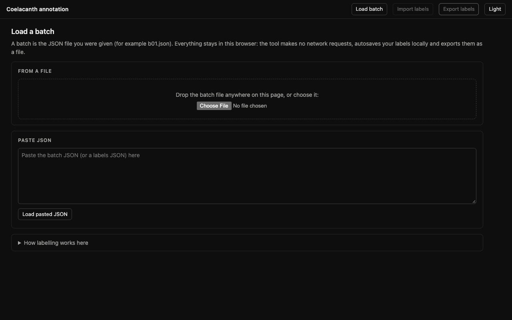
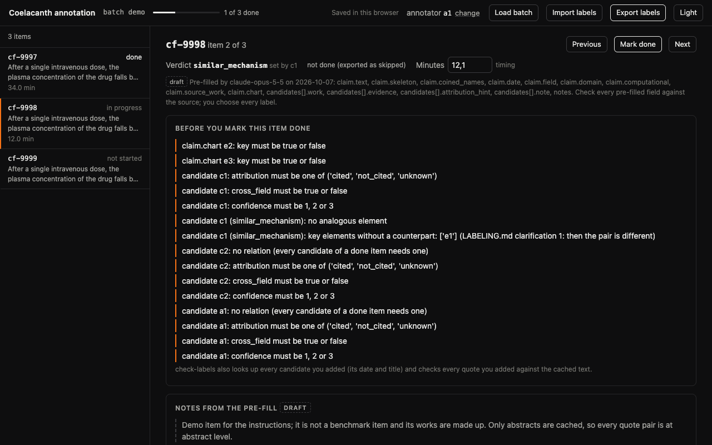
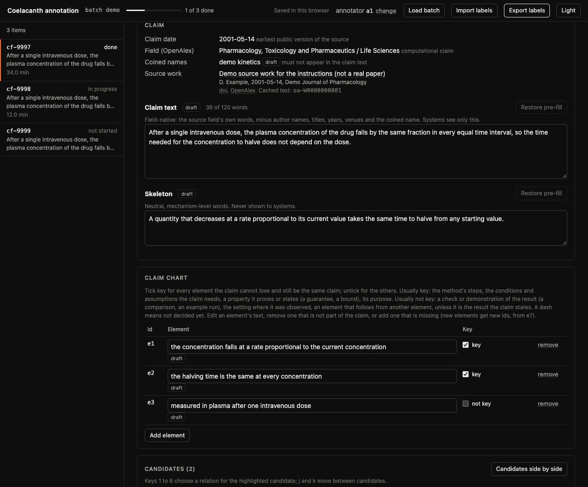
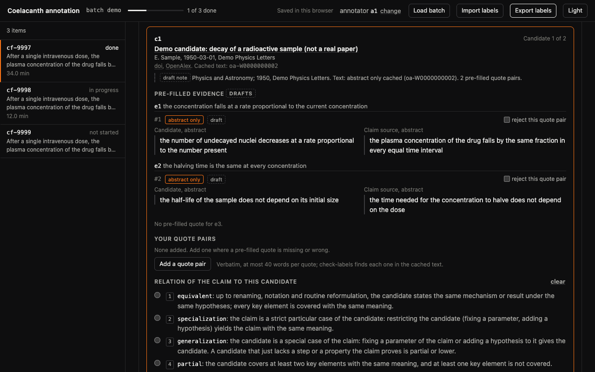
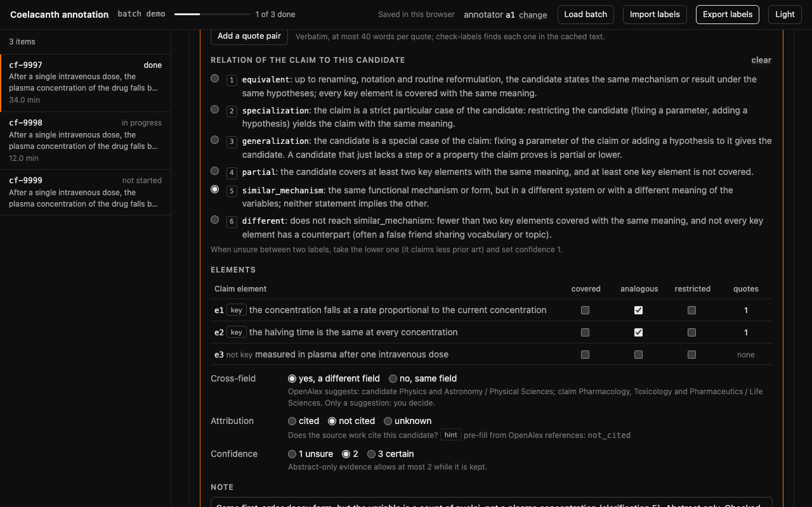
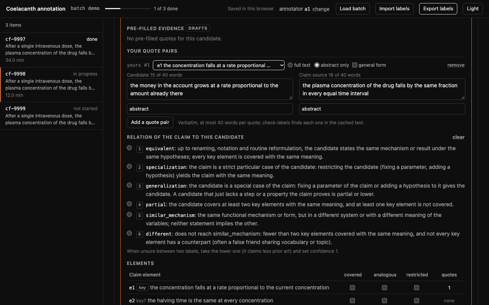
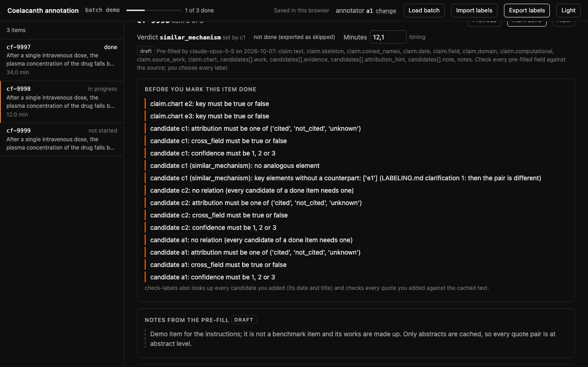
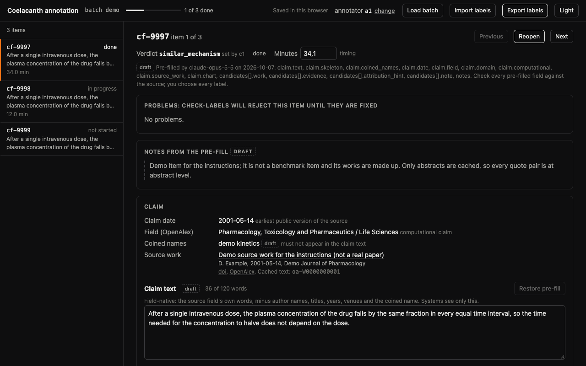
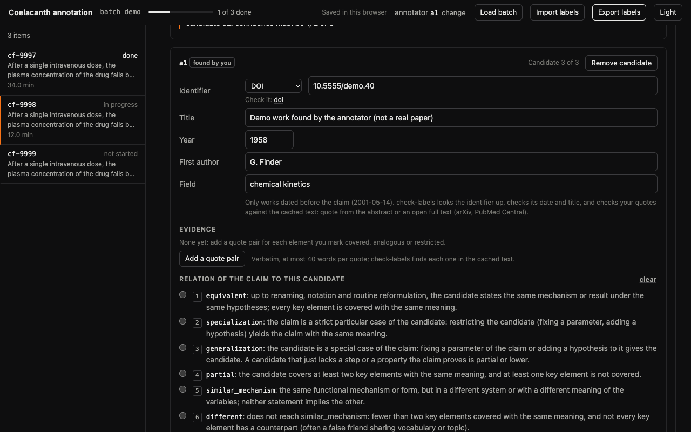
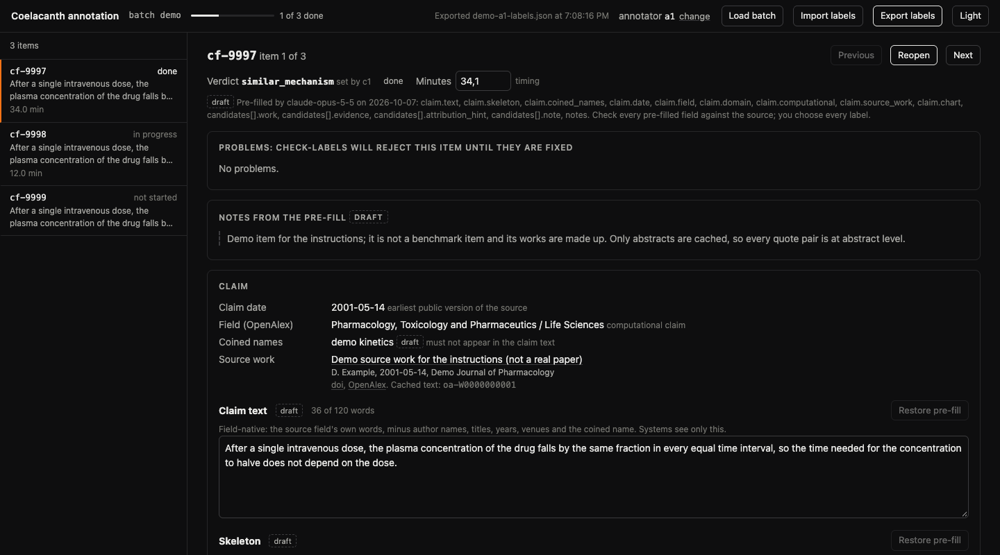

# Инструкция: от получения файлов до отправки результатов

Этот файл объясняет, как работать в инструменте разметки шаг за шагом. Что значат метки и как выбирать между ними, написано в [правилах разметки](pravila-razmetki.md) и в [памятке](pamyatka.md). Ответы на частые вопросы собраны в [FAQ](faq.md).

Инструмент на английском. Названия кнопок и полей ниже даны так, как они написаны на экране. Картинки сделаны на демонстрационном батче `demo` с выдуманными работами (в их названиях написано «not a real paper»): это не пункты бенчмарка и не учебный батч, метки на картинках показывают только, как выглядит экран.

Содержание:
1. Что вам пришлют
2. Подготовьте браузер
3. Откройте инструмент и загрузите батч
4. Введите свой ID
5. Как устроен экран
6. Один пункт, шаг за шагом
7. Пункты без предзаполнения
8. Пункты без кандидатов (методы, придуманные ИИ-моделями)
9. Как самому искать более ранние работы
10. Экспорт и отправка
11. Частые предупреждения и что с ними делать
12. Если застряли

## 1. Что вам пришлют

- `annotate.html`: инструмент разметки. Это один файл. Он работает без интернета и без установки.
- Файл батча (batch), то есть набор пунктов для разметки. У каждого разметчика своя личная копия каждого батча: в имени файла батч и ваш ID, например `b01-a1.json`, потом `b02-a1.json`. Открывайте только свою копию.
- Учебный батч, а после того как вы его сделаете, ключ к нему (ответы с объяснениями).
- Эти документы.
- Ваш ID разметчика, например `a1`.

Сложите всё в одну папку на своём компьютере, например `Coelacanth` на рабочем столе. Не выкладывайте файлы в общие чаты и общие папки.

## 2. Подготовьте браузер

- Нужен компьютер и свежий Chrome, Firefox, Safari или Edge. На телефоне инструмент откроется, но работать с двумя статьями на нём неудобно.
- Работайте в обычном окне, не в режиме инкогнито. Инструмент сохраняет вашу работу в памяти браузера, а режим инкогнито стирает её при закрытии.
- Работайте в одном и том же браузере на одном компьютере. Другой браузер не видит сохранённую работу. Чтобы перейти на другой компьютер, используйте Export labels и Import labels (раздел 10).
- Работайте в отдельном профиле браузера без расширений. Некоторые расширения отправляют текст открытой страницы на свои серверы, а на странице содержимое пунктов.
- Переключите встроенную проверку орфографии браузера на простую, локальную: в полях текста утверждения и скелета инструмент включает проверку орфографии, а расширенная проверка отправляет набранный текст на серверы. Chrome: Настройки → Языки → Проверка правописания → базовая проверка (не улучшенная: она отправляет текст в Google). Edge: Настройки → Языки → помощь в написании текста: базовая проверка вместо Microsoft Editor. В Firefox и Safari проверка орфографии локальная. Если не нашли такую настройку, работайте в отдельном профиле браузера, где проверка орфографии выключена.
- Не очищайте историю и данные сайтов, пока не сделали экспорт.

## 3. Откройте инструмент и загрузите батч

1. Дважды щёлкните `annotate.html`. Откроется страница **Load a batch**.
2. Перетащите файл батча в окно браузера или выберите его кнопкой в блоке **From a file**.
3. Есть и запасной путь: откройте файл батча в текстовом редакторе, скопируйте всё, вставьте в поле **Paste JSON** и нажмите **Load pasted JSON**.

Если файл не тот или повреждён, страница покажет сообщение красным. Проверьте, что вы выбрали файл батча (например `b01-a1.json`), а не файл с вашими метками (`b01-a1-labels.json`).

*Экран 1. Загрузка батча: перетащите файл в окно или выберите его в блоке From a file.*

Внизу этой страницы есть раскрывающийся блок **How labelling works here** с короткой справкой на английском.

В следующий раз инструмент сам откроет последний батч, с которым вы работали. Кнопка **Load batch** вверху возвращает к странице загрузки, кнопка **Back to batch** возвращает к работе.

## 4. Введите свой ID

После загрузки появится страница **Your annotator ID**, если в этом браузере ID ещё не сохранён (обычно в первый раз, на учебном батче). Введите свой ID латинскими буквами и цифрами, ровно как его дал Дамир (например `a1`), и нажмите **Continue**. ID попадёт в файл, который вы отправите Дамиру. В вашей личной копии поле уже заполнено ID из копии. Дальше браузер помнит ID, и при загрузке следующих батчей этой страницы не будет.

Если вверху пункта красным написано, что эта копия для другого разметчика (*This copy of batch ... is for annotator ..., and you are .... Load your own copy.*), проверьте две вещи. Файл чужой (в его имени не ваш ID): загрузите свою копию. Файл ваш: значит, в браузере сохранён не тот ID (например, опечатка на учебном батче); исправьте его ссылкой **change** рядом с ID в верхней панели.

В остальных случаях менять ID не нужно.

## 5. Как устроен экран

### 5.1. Верхняя панель, список пунктов, заголовок пункта

**Верхняя панель**: название батча, полоска прогресса (*12 of 30 done*), отметка о сохранении, ваш ID, кнопки **Load batch**, **Import labels**, **Export labels** и **Light** или **Dark** (светлая или тёмная тема).

**Список пунктов слева**: ID пункта (например `cf-0001`), статус, первые слова текста утверждения и минуты. Статусы:
- *not started*: вы ещё ничего не меняли;
- *in progress*: начали, но не закончили;
- *done*: пункт отмечен как готовый;
- *done, 2 to fix* (оранжевым): пункт отмечен как готовый, но в нём остались проблемы.

**Заголовок пункта**: ID, *item 3 of 30*, значок *no pre-fill* у пунктов без предзаполнения, кнопки **Previous**, **Mark done** и **Next**. Ниже строка **Verdict** (вердикт, его считает инструмент), статус пункта и поле **Minutes** с состоянием таймера.

*Экран 2. Список пунктов слева, справа заголовок пункта: вердикт, статус, минуты.*

Таймер показывает своё состояние рядом с полем Minutes:
- *timing*: время идёт;
- *paused: window not focused*: вы в другом окне;
- *paused: page hidden*: вы на другой вкладке;
- *paused: idle for 10 minutes*: 10 минут без мыши и клавиатуры.

Важно: пока вы читаете статью на другой вкладке или в другом окне, таймер стоит. Это время нужно добавить вручную (раздел 6, шаг 12). Иначе оно не будет оплачено.

### 5.2. Утверждение и карта утверждения

Под заголовком идёт **окно предупреждений**, о нём в шаге 11. Ниже блок **Notes from the pre-fill** с пометкой *draft*: факты о пункте (что удалось прочитать, у каких кандидатов нет открытого текста, что с датами). У пунктов без предзаполнения на его месте блок **Instructions**.

Блок **Claim**:
- **Claim date**: дата утверждения, то есть самая ранняя публичная версия исходной работы. Кандидаты засчитываются, только если они раньше этой даты.
- **Field (OpenAlex)**: область исходной работы по базе OpenAlex и пометка *computational claim* (вычислительное утверждение: метод или формула) или *non-computational claim* (сущности и их связи, например в биологии).
- **Coined names**: авторские названия, которых не должно быть в тексте утверждения.
- **Source work**: исходная работа. Название ведёт на статью, рядом ссылки doi, arXiv, PubMed, OpenAlex, open access и строка *Cached text*, о ней ниже.
- **Claim text**: текст утверждения, со счётчиком слов (*87 of 120 words*) и кнопкой **Restore pre-fill**, которая возвращает предзаполненный вариант.
- **Skeleton**: скелет.

Значки рядом с полями: *draft* (пунктирная рамка) значит, что текст предзаполнен и вы его не меняли; *edited* значит, что вы его изменили; *added* или *yours* значит, что это ваш элемент.

Блок **Claim chart**: таблица элементов карты. В каждой строке id (`e1`), текст элемента (его можно править), флажок **Key** и ссылка **remove**. Ниже кнопка **Add element**. Удалённые предзаполненные элементы перечислены в строке *Removed from the pre-fill*, их можно вернуть ссылкой **restore**.

У флажка **Key** три состояния. Сначала прочерк и подпись *not decided*. Один щелчок: *key* (ключевой). Второй щелчок: *not key* (не ключевой). Перед Mark done у каждого элемента должно быть решение, и хотя бы один элемент должен быть ключевым.

*Экран 3. Утверждение (дата, область, авторские названия, исходная работа, текст, скелет) и карта утверждения с флажками Key.*

**Что значит Cached text.** Цитаты проверяются слово в слово по сохранённой копии текста (кэшу). Начало ключа показывает, что именно сохранено и откуда копировать цитаты:

| Начало ключа | Что сохранено | Откуда копировать цитату |
|---|---|---|
| `oa-` | только аннотация из OpenAlex | страница работы в OpenAlex (ссылка OpenAlex) |
| `arxivabs-` | только аннотация с arXiv | страница работы на arXiv |
| `arxiv-` | полный текст с arXiv | статья на arXiv |
| `pmc-` | полный текст из PubMed Central | статья в PubMed Central |
| `aio-` | текст метода, придуманного ИИ-моделью | блок *Text of the generated method* под исходной работой (раздел 8) |

Если строки *Cached text* нет, текст этой работы не сохранён, и цитаты из неё никто не сможет проверить. Читать такую работу можно (например, через библиотеку), но перед тем как цитировать, напишите Дамиру.

### 5.3. Кандидат и его цитаты

Блок **Candidates (N)** содержит карточку каждого кандидата: `c1`, `c2` и так далее. Если кандидатов несколько, кнопка **Candidates side by side** ставит их рядом (удобно на широком экране), **Stack candidates** возвращает одного под другим.

В карточке:
- название работы со ссылками, авторы, дата, журнал и *Cached text*;
- заметка с пометкой *draft note*: только факты (область, год, журнал, какой текст сохранён, сколько пар цитат предзаполнено);
- **Pre-filled evidence**: предзаполненные пары цитат, сгруппированные по элементам карты. У каждой пары номер (`#1`), значок *full text* или *abstract only*, иногда *general form*, и флажок **reject this quote pair**. Слева цитата из кандидата (*Candidate*, с местом), справа цитата из исходной работы (*Claim source*, с местом);
- **Your quote pairs** и кнопка **Add a quote pair**: ваши собственные пары цитат.

*Экран 4. Карточка кандидата: работа, заметка и предзаполненные пары цитат с флажком reject this quote pair.*

### 5.4. Метки кандидата

Ниже в той же карточке:
- **Relation of the claim to this candidate**: шесть меток с номерами от 1 до 6 и коротким определением. Ссылка **clear** снимает выбор.
- **Elements**: таблица элементов карты с флажками **covered** (покрыт с тем же смыслом), **analogous** (соответствует только по роли), **restricted** (получается из общей формы кандидата) и счётчиком **quotes** (сколько сохранённых пар цитат у элемента).
- **Cross-field**: *yes, a different field* или *no, same field*. Под ним подсказка OpenAlex об областях, только подсказка.
- **Attribution**: *cited*, *not cited* или *unknown*. У предзаполненных кандидатов под ним черновая подсказка из списков литературы OpenAlex; у кандидатов, которых вы добавили сами, и в пунктах без черновика подсказки нет.
- **Confidence**: *1 unsure*, *2*, *3 certain*.
- **Note**: ваша заметка о кандидате.

*Экран 5. Метки кандидата: отношение, таблица элементов, cross-field, атрибуция, уверенность, заметка.*

Клавиши (когда курсор не стоит в текстовом поле): цифры от 1 до 6 выбирают метку для выделенного кандидата (его рамка оранжевая), `j` и `k` переходят к следующему и предыдущему кандидату, `]` и `[` к следующему и предыдущему пункту.

Ниже всех карточек кнопка **Add a candidate you found** (раздел 9), а в самом низу блок **Your notes**: заметки ко всему пункту.

## 6. Один пункт, шаг за шагом

Делайте шаги по порядку. В среднем чтение и разметка пункта занимают 30-40 минут, плюс собственный поиск (раздел 9); трудный пункт может занять больше часа. Не торопитесь: оплата почасовая.

**Шаг 1. Прочитайте заметки и исходную работу.** Сначала блок Notes from the pre-fill: в нём сказано, что удалось прочитать и чего нет. Потом исходную работу: как минимум аннотацию и раздел с методом или результатом, а лучше полностью, если полный текст доступен.

**Шаг 2. Проверьте и поправьте текст утверждения (Claim text).** Сверьте его с исходной работой. Текст должен:
- говорить об одном утверждении, не длиннее 120 слов;
- звучать так, как пишет исходная работа: её термины и обозначения;
- не содержать имён авторов (и методов, названных в честь людей), названий работ, годов, журналов и авторских названий из строки Coined names.

Не переводите текст на нейтральный язык и не обобщайте его. Перевод между словарями областей это как раз то, что мы проверяем у систем. Если предзаполненный текст неточен, исправьте его. Пишите по-английски.

Если черновик говорит то, чего нет в доступном вам тексте исходной работы (например, сохранена только аннотация, а деталь взята из полного текста), не удаляйте это сразу: напишите в **Your notes**, что не смогли проверить, и спросите Дамира.

**Шаг 3. Проверьте скелет (Skeleton).** То же утверждение нейтральными словами, без жаргона области. Скелет должен отличаться от текста утверждения. Пример из правил: текст про «площадь под кривой глюкозотолерантного теста», скелет про «интеграл функции, известной только в точках».

**Шаг 4. Проверьте карту и отметьте ключевые элементы.** В карте должно быть от двух до шести элементов, по одному на каждый отдельный шаг или условие утверждения. Если элемент лишний, удалите его (**remove**). Если чего-то не хватает, добавьте (**Add element**). Если текст неточен, поправьте его. Затем решите для каждого элемента, ключевой ли он. Тест: уберите элемент мысленно. Если это уже не то же утверждение, элемент ключевой. Что обычно ключевое: шаги метода; условия и допущения, без которых утверждение не держится; свойство, которое утверждение доказывает или заявляет (гарантия, оценка); цель, ради которой утверждение сделано. Что обычно не ключевое: проверка или демонстрация результата (сравнение, пример расчёта); обстановка, в которой это наблюдали; элемент, который следует из другого элемента карты, если это не тот вывод, который утверждение заявляет (такой вывод ключевой).

Не склеивайте разные шаги в один элемент. Пример P1 в правилах показывает, почему: от того, сколько элементов покрыто, зависит, будет ли метка `partial`.

**Шаг 5. Для каждого кандидата проверьте дату.** Кандидат засчитывается, только если он опубликован раньше даты утверждения (Claim date). Считается самая ранняя публичная версия, препринт тоже. У предзаполненного кандидата кнопки удаления нет. Если видите, что он на самом деле вышел в тот же день или позже, всё равно поставьте ему метку по текстам, как обычно, напишите в заметке к кандидату «published on or after the claim date» и откуда вы это знаете, и сообщите Дамиру: он решит при разборе, оставить кандидата или исключить.

**Шаг 6. Прочитайте кандидата и проверьте предзаполненные цитаты.** Для каждой пары цитат спросите себя:
- Цитата из кандидата правда говорит то, что сказано в элементе карты (весь элемент или его часть), с тем же смыслом?
- Цитата из исходной работы правда относится к этому элементу?
- Цитата не вырвана из контекста?

Если хотя бы на один вопрос ответ «нет», поставьте флажок **reject this quote pair**. Отклонённая пара не удаляется, она просто не считается.

Как отвечать на эти вопросы:
- Оставляйте пару, если цитата подтверждает элемент, даже если в ней есть и другое. Отклоняйте, если она не про этот элемент.
- Если пара подтверждает только часть элемента, тоже оставьте её и добавьте ещё одну пару для остального (шаг 8). Элемент покрыт, только если его сохранённые пары вместе подтверждают его целиком; для названного стандартного метода действует уточнение 2 (ниже). Правила, раздел 3, уточнение 9.
- Цитата может подтверждать элемент через один стандартный шаг рассуждения из учебника вашей области. Тогда оставьте пару, запишите этот шаг одной фразой по-английски в заметке к кандидату и ставьте уверенность не выше 2. Если нужно больше одного такого шага или вы в шаге не уверены, отклоните пару. Шаг не должен добавлять посылку, которой нет в тексте кандидата (например, что ошибки распределены нормально). Если метка получается только с такой посылкой, вы колеблетесь между двумя метками: возьмите нижнюю, поставьте уверенность 1 и назовите посылку в заметке к кандидату (правила, раздел 3, уточнения 4 и 7).
- Если цитата кандидата только называет стандартный метод с однозначным учебным определением, элементы из этого определения считаются покрытыми; напишите в заметке, на какое определение вы опирались, и ставьте уверенность не выше 2, если формулы в тексте кандидата нет (уточнение 2).
- Одну и ту же цитату можно использовать для двух элементов, если она подтверждает каждый. Для каждого элемента нужна своя пара.

**Шаг 7. Отметьте элементы.** В таблице **Elements** для каждого элемента карты поставьте флажки:
- **covered**: кандидат содержит этот элемент с тем же смыслом, целиком (уточнение 9);
- **analogous**: кандидат содержит элемент с той же ролью, но смысл другой (для `similar_mechanism`);
- **restricted**: утверждение получает этот элемент, фиксируя параметр или добавляя условие к более общей форме кандидата (для `specialization`);
- ничего, если элемента в кандидате нет.

Флажки covered и analogous вместе ставить нельзя. Флажок restricted ставится вместе с covered: для `specialization` все ключевые элементы covered, а ограниченные ещё и restricted (правила, раздел 3, уточнение 6).

Для `generalization` отметьте covered у ключевых элементов, которые есть в кандидате с тем же смыслом, а элемент, который убрало ограничение (в примере G1 ограничение p = 0 убирает e3), не отмечайте и в заметке к кандидату напишите, каким ограничением кандидат получается из утверждения (уточнение 8).

Для `similar_mechanism` у каждого ключевого элемента должно быть соответствие: covered или analogous, и хотя бы один ключевой элемент analogous. Если у какого-то ключевого элемента соответствия нет, это `different` (уточнение 1). Инструмент это проверяет: если у ключевого элемента нет ни covered, ни analogous, а метка `similar_mechanism`, в окне предупреждений появится `key elements without a counterpart`, а если ни один ключевой элемент не отмечен analogous, появится `no analogous key element`.

Отметки у неключевых элементов. Метку решают только ключевые элементы (правила, раздел 3). Отметить covered или analogous у неключевого элемента можно: метку это не меняет, а для covered у неключевого элемента пара цитат не нужна. Но две проверки смотрят на все отмеченные элементы, ключевые и неключевые: при метке `similar_mechanism` у каждого элемента с отметкой analogous должна быть сохранённая пара цитат (иначе `analogous elements without evidence`), а при метке `specialization` у каждого элемента с отметкой restricted должна быть пара с галочкой general form (иначе `no general-form quote for`). Приложите пару или снимите флажок. И analogous у неключевого элемента не заменяет analogous у ключевого: для `similar_mechanism` хотя бы один ключевой элемент должен соответствовать только по роли (уточнение 1).

**Шаг 8. Добавьте недостающие цитаты.** У каждого отмеченного элемента должна быть хотя бы одна сохранённая пара цитат (счётчик quotes не должен показывать *none*). Элемент покрыт, только если его сохранённые пары вместе подтверждают его целиком: если пара подтверждает только часть элемента, оставьте её и добавьте ещё одну пару для остального. Если для остального цитаты нет, элемент не покрыт: снимите covered. Для названного стандартного метода действует уточнение 2 (правила, раздел 3, уточнения 2 и 9). Если предзаполненной пары нет, вы её отклонили или нужна пара для остальной части элемента, нажмите **Add a quote pair**:
1. В списке *choose an element* выберите элемент карты.
2. Отметьте, откуда цитата: *full text* или *abstract only*.
3. В поле *Candidate* вставьте цитату из кандидата, ниже напишите место (например *abstract*, *section 3*, *eq. 2*, *p. 5*).
4. В поле *Claim source* вставьте цитату из исходной работы и её место.
5. Для элемента restricted цитата из кандидата должна показывать его общую форму. Поставьте галочку **general form**. Цитата из исходной работы в такой паре должна показывать частный случай, который берёт утверждение (например, одно число k для всех коэффициентов). Если в сохранённом тексте исходной работы такой цитаты нет, возьмите ближайшую, ставьте уверенность не выше 2 и напишите в заметке к кандидату, откуда этот элемент карты (например «kI is stated only in the full text»).

*Экран 6. Новая пара цитат: элемент карты, уровень текста, цитата и место в кандидате и в исходной работе, галочка general form.*

Правила для цитат:
- Копируйте, не перепечатывайте. Цитата должна быть одним непрерывным куском текста.
- Без многоточий, без своих вставок в квадратных скобках, без изменения регистра букв.
- Не больше 40 слов. Счётчик под полем покажет *N of 40 words*.
- Только из текста, который сохранён в кэше (таблица в разделе 5.2). Цитата из PDF за пейволлом не пройдёт проверку.
- Лучше брать предложения из слов, а не формулы, таблицы, подписи к рисункам и куски через разрыв страницы: формулы при сохранении текста часто искажаются.
- Если среди сохранённых пар кандидата есть пара только из аннотации (*abstract only*), уверенность не может быть выше 2. Это касается сохранённых пар, а не того, что вы читали. Не отклоняйте верную пару ради уверенности 3.

Инструмент не может сам проверить цитату дословно: это делает Дамир программой check-labels после того, как вы отправите файл.

**Шаг 9. Выберите отношение.** Идите по порядку решения из [памятки](pamyatka.md) и остановитесь на первом «да». Инструмент проверит, что отметки в Elements согласуются с меткой: например, для `partial` нужны минимум два покрытых ключевых элемента и хотя бы один непокрытый.

**Шаг 10. Cross-field, атрибуция, уверенность, заметка.**
- **Cross-field**: из другой ли области кандидат, решаете вы. Подсказка OpenAlex только подсказка: OpenAlex часто ошибается, особенно для старых работ. Несколько подсказок, как решать (это не правила, а ориентиры): у разных областей свои журналы, конференции, учебники и словарь. Если журналы кандидата и утверждения относятся к разным дисциплинам (статистика и медицина, физика и информатика), обычно это *yes*. Если это разделы одной дисциплины (две медицинские специальности), смотрите на словарь: если ключевые понятия названы разными словами, *yes*; если теми же, *no*. Если сомневаетесь, решите по словарю и напишите сомнение в заметке к кандидату. Примеры из правил: статистика и обработка сигналов (E2), маркетинг и популяционная биология (G1), биофизика и гидрология (G2).
- **Attribution**: цитирует ли исходная работа этого кандидата.
  1. Если у вас есть полный текст исходной работы, проверьте её список литературы.
  2. Если полного текста нет, проверьте список литературы исходной работы в OpenAlex. Откройте в браузере `https://api.openalex.org/works/W...`, где `W...` это идентификатор исходной работы (он в её ссылке OpenAlex в блоке Claim). Найдите на странице поле `referenced_works_count` (сколько работ в списке) и поиском по странице (Ctrl+F, на Mac Cmd+F) W-идентификатор кандидата в списке `referenced_works`. W-идентификатор кандидата есть в его ссылке OpenAlex; для кандидата, которого вы добавили по DOI, найдите его на openalex.org.
  3. Если в OpenAlex список есть и кандидат в нём есть, выберите *cited*. Если список есть, а кандидата в нём нет, выберите *not cited* и напишите в заметке: «checked OpenAlex references (N works)», где N это `referenced_works_count`. Если OpenAlex списка не показывает (`referenced_works_count` равен 0), выберите *unknown*.

  Черновая подсказка в инструменте взята из того же списка OpenAlex, но перепроверьте её сами.
- **Confidence**: 3, если метка ясна, сомнений нет и среди сохранённых пар нет пар только из аннотации (для `different` без пар цитат 3 можно, если по аннотации кандидата ясно, что ключевых элементов в нём нет); 2, если среди сохранённых пар есть пары только из аннотации, или есть сомнение в одном элементе или одной цитате, или вы опирались на определение названного метода или на один учебный шаг; 1, если вы колебались между двумя метками (назовите их в заметке). Подробно: правила, раздел 3, уточнение 7.
- **Note**: коротко, по-английски, почему такая метка. Обязательно напишите в заметке: между какими двумя метками вы выбирали и почему взяли нижнюю (если уверенность 1); каким ограничением кандидат получается из утверждения (если метка `generalization`); на какое определение метода или какой учебный шаг вы опирались; откуда элемент карты, которого нет в сохранённом тексте; как проверяли атрибуцию.

Повторите шаги с 5 по 10 для каждого кандидата.

**Шаг 11. Поищите более ранние работы сами и проверьте окно предупреждений.** Поиск описан в разделе 9. Каждую найденную подходящую работу добавьте кнопкой **Add a candidate you found** и разметьте так же, как остальных.

Затем посмотрите на окно предупреждений вверху пункта. Пока пункт не готов, оно называется **Before you mark this item done** и перечисляет всё, чего не хватает. Когда всё заполнено, там написано *Nothing left: the labels are complete.* Ниже может быть второй список, **Also flagged by check-labels after merging**: это то, что программа проверки отклонит при слиянии (например, нет цитаты для отмеченного элемента). Его тоже нужно очистить, кроме двух видов записей, которые вы убрать не можете и которые служат сведением для Дамира:
- `rule 4: ... no text ... is cached ... tell Damir`: текста работы нет в кэше, и ваши цитаты из неё нечем проверить. Напишите Дамиру; запись может остаться.
- `rule 6: candidate ... is not clearly before the claim date`: ваш добавленный кандидат вышел в том же году, что и утверждение. Если вы проверили точную дату и он раньше, оставьте его, а дату напишите в заметке к кандидату; программа проверки сверит её сама.

Что значат частые предупреждения, написано в разделе 11.

*Экран 7. Окно предупреждений у незаконченного пункта: что ещё не заполнено. Если есть записи для программы проверки, ниже появляется второй список, Also flagged by check-labels after merging.*

Посмотрите и на вердикт. Если он `equivalent` или `specialization`, рядом появится значок *already-done verdict*: ещё раз проверьте каждый ключевой элемент, это самый дорогой вид ошибки. Если вердикт `nothing_close`, напишите в **Your notes**, где вы искали: области, источники (базы), диапазон дат и что не удалось прочитать (раздел 9).

**Шаг 12. Поправьте минуты.** Таймер не считает время, проведённое на других вкладках и в других окнах. Посмотрите на часы: сколько всего вы потратили на пункт, включая чтение статей и поиск? Впишите это число в поле **Minutes**. Записывайте честно, и в большую, и в меньшую сторону: эти минуты оплачиваются и входят в раздел статьи о затратах.

Удобный способ: когда открываете новый пункт, запишите время начала на листке.

**Шаг 13. Нажмите Mark done.** Кнопка станет **Reopen**, статус в списке станет *done*. Окно предупреждений после этого называется *Problems: check-labels will reject this item until they are fixed*; у готового пункта в нём должно быть написано *No problems.* Если нужно что-то исправить, нажмите **Reopen**, исправьте и снова **Mark done**. Пункты, которые не отмечены как готовые, попадают в экспорт как пропущенные (*skipped*).

*Экран 8. Пункт готов: в окне предупреждений No problems, кнопка Mark done сменилась на Reopen, в списке статус done.*

Переходите к следующему пункту кнопкой **Next** или клавишей `]`.

## 7. Пункты без предзаполнения

У некоторых пунктов в b02 стоит значок *no pre-fill*. В них заполнены только факты: дата, область, исходная работа и работы-кандидаты. Всё остальное делаете вы:
1. Прочитайте исходную работу.
2. Напишите текст утверждения (по-английски, словами исходной области, до 120 слов).
3. Напишите скелет.
4. В поле **Coined names** перечислите через запятую авторские названия, которые придумала исходная работа (имя метода, аббревиатура). Если их нет, оставьте поле пустым.
5. Добавьте элементы карты кнопкой **Add element** (от двух до шести) и отметьте ключевые.
6. Для каждого кандидата добавьте все пары цитат сами и поставьте все метки.

Так мы измеряем, насколько предзаполнение влияет на разметку. Поэтому не ищите предзаполненную версию этого пункта и не спрашивайте о ней другого разметчика.

## 8. Пункты без кандидатов (методы, придуманные ИИ-моделями)

В b02 есть пункты (всего 10), где исходная работа не статья, а метод, который придумала ИИ-модель. У исходной работы значок *AI-origin method*, ключ кэша начинается с `aio-`, а в блоке Candidates написано, что кандидатов пока нет.

Ваша задача та же: проверить, не сделано ли это раньше людьми. Ищите сами (раздел 9), добавляйте найденное и размечайте. Читать текст метода можно и нужно: это и есть исходная работа.

Текст метода показан в самом инструменте: в блоке Claim под исходной работой нажмите на строку **Text of the generated method (this is the source to read)**, и она раскроется. Это и есть исходная работа: читайте её и копируйте оттуда цитаты для поля *Claim source*.

Если вы ничего не нашли на уровне `similar_mechanism` или выше, вердикт будет `nothing_close`. Это нормальный результат, а не неудача. Главное, чтобы в **Your notes** был описан ваш поиск.

## 9. Как самому искать более ранние работы

Ищите не только в области утверждения, но и в других областях, где тот же механизм мог появиться под другим названием. Это главное в нашей задаче.

**Как думать.**
1. Начните со скелета: что делает механизм, без слов области?
2. Спросите себя: где ещё мог понадобиться такой механизм? Выпишите 2-4 области. Например: физика, статистика, обработка сигналов, экономика, биология, химия, инженерия, исследование операций.
3. Для каждой области подумайте, как там назвали бы то же самое. Примеры из правил: «площадь под кривой» в медицине это «численное интегрирование» в математике (E1); «добавить единицу к счётчикам слов» в обработке языка это «псевдосчётчик» в актуарной статистике (S2); «принятие нового продукта через подражание» в маркетинге это «логистический рост» в биологии (G1).
4. Ищите короткими запросами из 2-5 слов на языке каждой области. Никогда не вставляйте в поиск текст утверждения целиком.
5. Просматривайте названия и аннотации. Близкие работы читайте полностью.
6. Смотрите обзоры и учебники в целевой области, списки литературы найденных работ и раздел «See also» в Википедии.

**Где искать.**
- Google Scholar (scholar.google.com). В меню слева можно ограничить годы.
- OpenAlex (openalex.org): поиск по работам с фильтром по году. Здесь же удобно взять идентификатор работы (W и цифры).
- arXiv (arxiv.org): расширенный поиск (Advanced Search) позволяет задать диапазон дат.
- PubMed (pubmed.ncbi.nlm.nih.gov) для биологии и медицины, с фильтром по дате.
- Электронная библиотека вашего университета: базы вроде ScienceDirect, SpringerLink, IEEE Xplore, JSTOR, Scopus, Web of Science, если у вас есть доступ.
- Википедия и учебники, чтобы сориентироваться в чужой области. Метку по ним не ставят: они только подсказывают, что читать.

Пользуйтесь только законным доступом к статьям.

**Даты.** Засчитываются только работы, опубликованные раньше даты утверждения. Если год совпадает с годом утверждения, проверьте точные даты, включая дату первой версии препринта.

**Как добавить найденную работу.** Нажмите **Add a candidate you found**. Появится карточка со значком *found by you*:
1. **Identifier**: выберите тип (DOI, OpenAlex ID, arXiv ID или PubMed ID) и вставьте идентификатор. Если формат верный, появится ссылка *Check it*: откройте её и убедитесь, что это та самая работа. Если формат неверный, появится красное сообщение.
2. **Title**: название работы, как в оригинале.
3. **Year**: год самой ранней публичной версии.
4. **First author**: фамилия первого автора.
5. **Field**: область словами, по-английски, например *hydrology*.
6. Дальше всё как у остальных кандидатов: пары цитат в блоке **Evidence**, отношение, элементы, cross-field, атрибуция, уверенность.

Кнопка **Remove candidate** убирает карточку. Не добавляйте работу, которая уже есть среди кандидатов. Инструмент предупредит об этом, только если вы ввели тот же идентификатор того же типа, что у кандидата (например, тот же DOI); если у кандидата указан OpenAlex ID, а вы ввели DOI, повтор найдёт уже программа проверки. Поэтому сначала сравните название с уже имеющимися кандидатами.

*Экран 9. Карточка найденного кандидата: идентификатор со ссылкой Check it, название, год, первый автор, область.*

Для цитат из добавленной работы подходят её аннотация в OpenAlex и полный текст на arXiv или в PubMed Central: Дамир при проверке автоматически сохранит эти тексты. Цитату из платной статьи проверить нельзя.

**Что добавлять.** Добавляйте работы, которые вы прочитали и сочли достаточно близкими, чтобы поставить им метку, включая близкие ложные совпадения (они получат `different`). Не нужно добавлять каждое просмотренное название: их количество вы запишете в заметке.

**Сколько искать.** Пример N1 в правилах показывает, что пишется в отчёте о поиске (охват), а не норму. Ориентир по времени: в обычном пункте с кандидатами 10-20 минут поиска, две-три области, 10-20 просмотренных названий. В пунктах без кандидатов (раздел 8) и в пунктах, где ближе `different` ничего не нашлось, поиск полный, как в N1: три области, около 40 названий, несколько работ прочитаны полностью, до 45 минут. Время поиска входит в минуты пункта и оплачивается.

**Что записать в Your notes.** Если вердикт `nothing_close`, обязательно, а в остальных случаях желательно, напишите по-английски, где вы искали. Образец:

> Searched: statistics, signal processing, econometrics; Google Scholar, OpenAlex and arXiv; works before 2001-05-14. Screened about 40 titles, read 5 in full. Not searched or could not read: patents, non-English literature; two candidates were paywalled and read at abstract level.

Никогда не пишите «novel», «not novel», «plagiarism» и подобное. Мы сообщаем только, что нашли и где искали.

## 10. Экспорт и отправка

1. Нажмите **Export labels** в верхней панели. Браузер скачает файл с именем вида `b01-a1-labels.json` (батч и ваш ID) в папку загрузок.
2. Если в пунктах, отмеченных как готовые, остались проблемы, сначала появится окно со списком и вопросом *Export anyway?*. Лучше нажать «Отмена», исправить проблемы и экспортировать снова.
3. Пункты, которые не отмечены как готовые, попадают в файл как пропущенные (*skipped*). Для промежуточной копии это нормально.
4. Отправьте файл Дамиру лично в Telegram (the author (contact given in the call for annotators)), не в общий чат.

*Экран 10. Экспорт: кнопка Export labels и сообщение о сохранённом файле в верхней панели.*

**Когда экспортировать.** В конце каждого рабочего сеанса, для подстраховки: храните файл у себя. Отправлять Дамиру нужно, когда вы закончили батч или когда он попросил.

**Что дальше.** Дамир запускает программу проверки (check-labels). Она сверяет каждую цитату слово в слово с сохранённым текстом и проверяет добавленные вами работы: что идентификатор существует, дата раньше даты утверждения и название совпадает. Если что-то не так, Дамир пришлёт список проблем. Откройте пункт, нажмите **Reopen**, исправьте, снова **Mark done**, экспортируйте и отправьте файл целиком ещё раз. Новый файл заменяет старый в работе, но Дамир хранит и первый: согласие разметчиков считается по первым ответам. Поэтому исправляйте форму (пустое поле, недословную цитату) и не меняйте метки, если Дамир об этом не просил. Если вы сами нашли ошибку в метке после отправки, исправьте её и отправьте файл заново с припиской, что именно изменили.

**Продолжить на другом компьютере.** Откройте `annotate.html` на новом компьютере, загрузите тот же батч, затем нажмите **Import labels** и выберите свой последний экспортированный файл.

## 11. Частые предупреждения и что с ними делать

Предупреждения написаны по-английски. В таблице фрагмент текста предупреждения и что делать. `c1` здесь означает любого кандидата.

| Фрагмент предупреждения | Что значит | Что делать |
|---|---|---|
| `candidate c1: no relation` | у кандидата нет метки | выберите одну из шести |
| `attribution must be one of` | не выбрана атрибуция | cited, not cited или unknown |
| `cross_field must be true or false` | не решено, другая ли область | yes или no |
| `confidence must be 1, 2 or 3` | не выбрана уверенность | 1, 2 или 3 |
| `abstract-only evidence allows confidence at most 2` | среди сохранённых пар есть пара только из аннотации, а уверенность 3 | поставьте 2; не отклоняйте верную пару ради уверенности 3 |
| `(partial): needs at least two covered key elements and one uncovered` | для `partial` покрыто меньше двух ключевых элементов, или покрыты все | проверьте covered и Key; возможно, нужна другая метка |
| `(equivalent): key elements not covered` | `equivalent`, но не все ключевые элементы покрыты | отметьте covered или выберите другую метку |
| `(specialization): no restricted element` | не отмечен ни один элемент restricted | отметьте ограниченный элемент |
| `(similar_mechanism): no analogous key element` | ни один ключевой элемент не отмечен analogous (analogous у неключевого элемента не считается) | отметьте analogous у ключевых элементов, которые соответствуют только по роли. Помните: у каждого ключевого элемента должно быть соответствие (covered или analogous), иначе это `different`; если все ключевые элементы покрыты с тем же смыслом, проверьте правило 1 (`equivalent`) |
| `(similar_mechanism): key elements without a counterpart` | у какого-то ключевого элемента нет ни covered, ни analogous | найдите соответствие в кандидате и отметьте его; если соответствия нет, по уточнению 1 это `different` |
| `marked both covered and analogous` | у элемента два флажка | оставьте один |
| `covered key elements without evidence` | у покрытого ключевого элемента нет сохранённой пары цитат | Add a quote pair, или снимите covered |
| `analogous elements without evidence` | то же для analogous | то же |
| `no general-form quote for` | у элемента restricted нет цитаты общей формы | добавьте пару с галочкой general form |
| `claim.chart has no key element` | нет ни одного ключевого элемента | отметьте Key |
| `claim.chart needs two to six elements` | элементов меньше двух или больше шести | добавьте или удалите элементы |
| `key must be true or false` | у элемента прочерк в Key | решите: key или not key |
| `element text is empty` | у элемента нет текста | напишите текст или удалите элемент |
| `claim.text contains ... surname` | в тексте фамилия автора, возможно в названии метода | опишите метод без имени |
| `claim.text contains a year` | в тексте год | уберите год |
| `claim.text contains the coined name` | в тексте авторское название | опишите вместо названия |
| `repeats three consecutive title words` | три слова подряд из названия исходной работы | перефразируйте, оставаясь в словаре области |
| `claim.text has ... words; the limit is 120` | текст длиннее 120 слов | сократите |
| `claim.skeleton repeats claim.text` | скелет совпадает с текстом | перепишите скелет нейтрально |
| `has ... words; the limit is 40` | цитата длиннее 40 слов | возьмите более короткий непрерывный кусок |
| `which is not in the chart (reject it)` | предзаполненная пара относится к элементу, которого нет в карте. Обычно так бывает, если вы удалили элемент, а потом сняли флажок reject у его пары (при удалении элемента его пары отклоняются сами) | отклоните пару (reject this quote pair) или верните элемент ссылкой restore |
| `no text of this candidate is cached` | ваши цитаты из этой работы нечем проверить | напишите Дамиру; запись может остаться, это сведение для него |
| `no text of the claim source is cached` | то же для исходной работы: ваши цитаты из неё нечем проверить | напишите Дамиру |
| `is not clearly before the claim date` | год вашего добавленного кандидата совпадает с годом утверждения | проверьте точные даты, включая первую версию препринта. Если кандидат раньше, оставьте его и напишите точную дату в заметке: запись не исчезнет, программа проверки сверит дату сама. Если кандидат вышел в тот же день или позже, удалите карточку (Remove candidate) |
| `is after the claim date` | год вашего добавленного кандидата позже утверждения | удалите карточку (Remove candidate) |
| `the same work as` | эта работа уже есть среди кандидатов | удалите добавленную карточку |
| `does not look like` | идентификатор в неверном формате | исправьте, например DOI начинается с 10. |
| `work needs one of the identifiers` | у добавленного кандидата нет идентификатора | впишите DOI, OpenAlex ID, arXiv ID или PubMed ID |
| `work has no title` (`year`, `first author`, `field`) | у добавленного кандидата не заполнено поле | заполните название, год, фамилию первого автора или область |
| `text_level must be 'abstract' when a quote comes from an abstract-only text` | у работы сохранена только аннотация, а в паре выбрано *full text* | выберите *abstract only* |
| `claim.text is empty` (`claim.skeleton is empty`) | текст утверждения или скелет пуст (обычно в пункте без черновика) | напишите текст или скелет |
| `minutes must be a number above 0` | поле Minutes пустое или 0 | впишите реальное время |

## 12. Если застряли

- **Непонятно правило.** Загляните в [правила](pravila-razmetki.md) и в [FAQ](faq.md). Если ответа нет, спросите Дамира. Не обсуждайте конкретные пункты с другим разметчиком.
- **Не можете выбрать метку.** Если вы колеблетесь между двумя конкретными метками, возьмите нижнюю из этих двух, поставьте уверенность 1 и назовите обе метки в заметке. Не спускайтесь ниже второй метки, о которой думали.
- **Нет доступа к тексту.** Напишите Дамиру: возможно, он найдёт открытую копию. Пока можно размечать по аннотации, с уверенностью не выше 2.
- **Пункт занял больше полутора часов, а ясности нет.** Не отмечайте его как готовый, напишите заметку о том, что мешает, переходите к следующему и сообщите Дамиру.
- **Предзаполненная заметка подсказывает метку** (например, «это то же самое, что...»). Это ошибка подготовки: сообщите Дамиру и решайте только по текстам.
- **Инструмент ведёт себя странно.** Сначала сделайте Export labels, чтобы не потерять работу. Потом напишите Дамиру, что вы делали и что увидели. Если можете, приложите скриншот.
